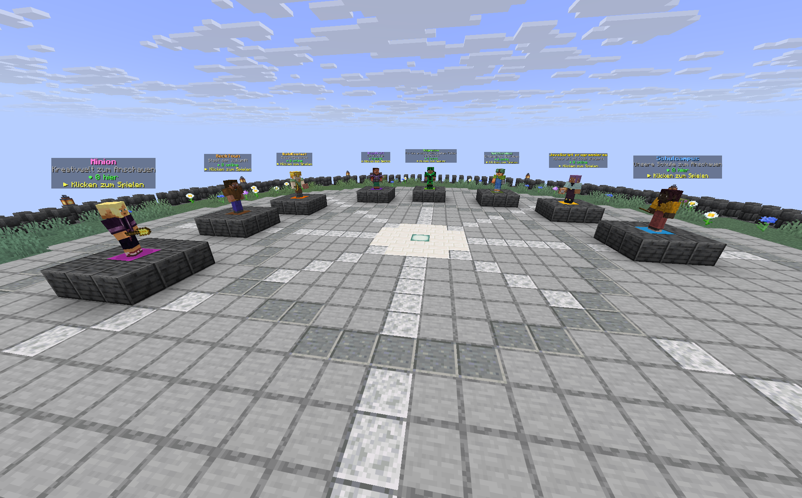
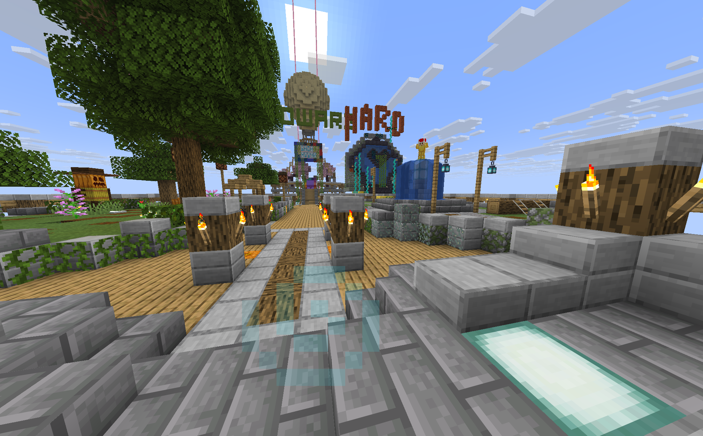

# MeckHub

Eingangswelt für den Lobby-Server: Spielfiguren (Mannequins) und ein Kompass-Menü führen zu den Spielen.

| Die Spielfiguren | Brunnen mit Toad in der alten Lobby |
|---|---|
|  |  |

*Echte Screenshots aus der Lobby von meckminecraft.de: links die neue Insel mit den Figuren
(Minion, MeckTown, BuildContest, OnyxCraft, Inigresso, SoftSurvival, JavaScript, Schulcampus),
rechts die alte Lobby „SpawnHub“, die über die Brücke angebunden ist.*

- `server:<name>` – Server im eigenen BungeeCord-Netz (Plugin-Nachricht „Connect“)
- `transfer:<host>:<port>` – Server auf anderen Rechnern über den Minecraft-Transfer (ab 1.20.5,
  Zielserver braucht `accepts-transfers=true`)
- `world:<name>` – Welt auf demselben Server (z. B. Multiverse)

Über jeder Figur: Name, Beschreibung, Spieler online (Server-List-Ping alle 10 s). In der Eingangswelt:
Abenteuermodus, kein Schaden/Hunger, Fall ins Leere → Spawn, Kompass in der Schnellleiste.

**Bauwelten** (`bauwelten:` in der config): Wer `meckhub.bauen.<welt>` oder `meckhub.bauen.*` hat,
baut dort im Kreativmodus; alle anderen schauen nur zu (Abenteuer, Fliegen, nichts verändern).
Steht die Lobby selbst in `bauwelten`, braucht man dort `meckhub.lobby.bauen` (nur Admins); Builder sind in
der Lobby im Abenteuermodus, WorldEdit-Befehle und -Werkzeuge sind für sie gesperrt.

Befehle: `/hub` (Spawn), `/hub menue`, Admin: `/hub setspawn`, `/hub figur <spiel> [entfernen]`,
`/hub liste`, `/hub reload`. Spiele, Skins und Ausrüstung in `config.yml`, Orte in `orte.yml`.

Bauen:

```
docker run --rm -v $PWD:/src -v /root/.m2:/root/.m2 -w /src \
  maven:3.9-eclipse-temurin-25 mvn -q -B package
```
